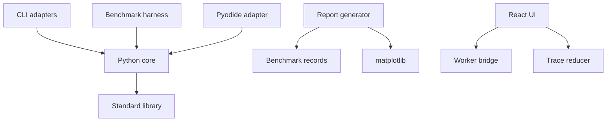

# Architecture

**State:** target structure; only the documentation files currently exist.

## Repository layout

```text
PathLab/
  README.md, AGENTS.md, LICENSE
  pyproject.toml, uv.lock
  docs/                         specifications and session records
  src/pathlab/
    model.py, validation.py, labels.py, result.py
    algorithms/                 dijkstra, bmssp, pivots, base case
    structures/                 block queue, AVL index, selection
    transform.py, observers.py, serialization.py, cli.py
  tests/                        unit, oracle, property, integration
  examples/                     small graph and trace fixtures
  benchmarks/
    configs/, generators/, runner.py, report.py
  results/                      curated raw records and reports
  frontend/
    package.json, package-lock.json
    src/                        editor, worker bridge, replay, inspectors
    public/                     built Python bundle and curated examples
    scripts/                    copy Python core for browser build
  .github/workflows/            validation and static deployment
  work/                         ignored temporary outputs
```

## Dependency rules



Core code must not import benchmark utilities, plotting, Pyodide, React, or test libraries. Graph validation and JSON adapters use the standard library. CLI uses `argparse`; observers are optional. Benchmark code may depend on the core; the reverse dependency is prohibited.

React state uses `useReducer` and scoped contexts; no global state library is required. SVG rendering is sufficient for the browser limits. Shared frontend types mirror the versioned wire contract, with runtime validation at import and worker boundaries.

## Python/browser packaging

Use the `src` package layout with a `pathlab` console entry point. A frontend pre-build script copies approved `src/pathlab` modules into a generated browser bundle preserving package structure. Never edit generated copies. The worker retrieves this bundle using the configured Vite base path and installs it into Pyodide's virtual filesystem.

Bundle metadata contains a source hash and release commit when available. The frontend verifies that the returned solver bundle identifier matches the requested build. CI checks bundle/source parity and a browser Python smoke function before algorithm integration.

Pin Pyodide separately from native Python and record its embedded Python version. Native and browser versions may differ; fixture parity is mandatory. Stable fixtures, deterministic vertex indexing, and canonical edge order support comparison.

## Deployment

Build a static site under the repository subpath. Include small pre-recorded traces as a fallback; label them recorded examples. Publish only curated native benchmark records, not arbitrary generated directories.

Validation CI runs fast Python tests, type/lint checks, frontend tests, browser smoke integration, and production build. Full-scale benchmark runs are manual and must name hardware. Deployment runs only after validation passes on the chosen release branch.

The repository and GitHub remote are now created; documentation is published on `docs/project-foundation`. No workflow or live site exists yet. Remaining bootstrap and release artifacts follow [roadmap](ROADMAP.md).
