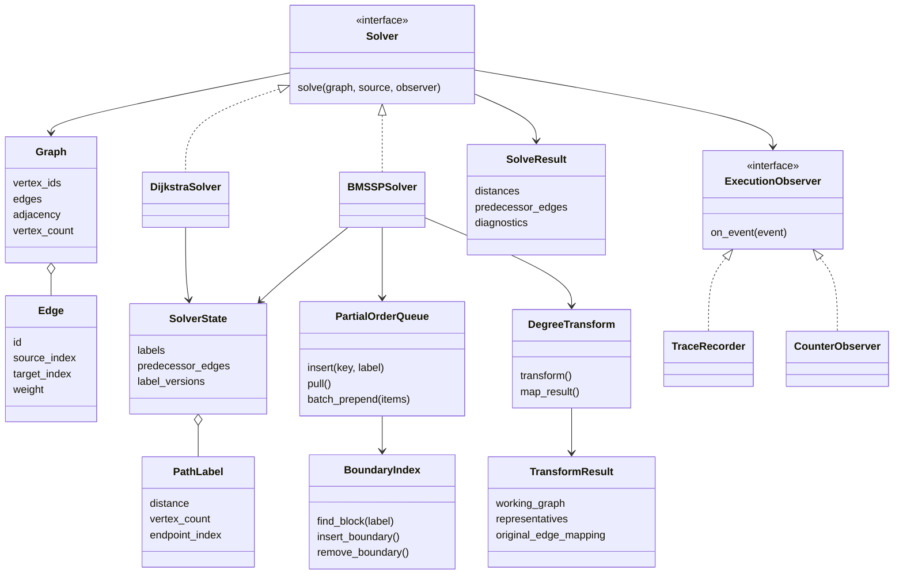
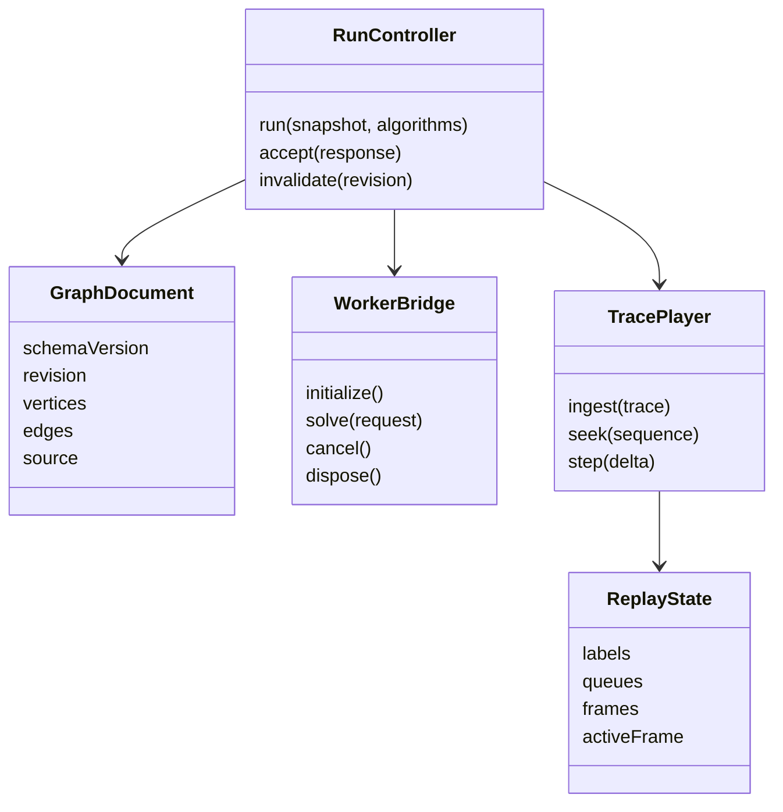

# Class design

**State:** proposed interfaces and ownership; no classes implemented.

## Python core

Use frozen dataclasses for graph records and results, mutable per-invocation solver state, and structural protocols for solvers and observers. Solvers retain no state across calls.

| Component | Responsibility and ownership |
|---|---|
| `Graph` / `Edge` | Immutable normalized graph; adjacency entries reference immutable edges; stable mappings preserve external IDs |
| `SolverState` | Owns current labels, predecessor edge indices, and update versions for one invocation |
| `PathLabel` | Weight, vertex count, endpoint; shared comparison helpers also inspect predecessor state for relaxation ties |
| `DijkstraSolver` | Owns its local heap and settled bookkeeping; never delegates solving to BMSSP |
| `BMSSPSolver` | Orchestrates reachability, transformation, parameters, recursion, and mapping; never silently delegates its top level to full Dijkstra |
| `PartialOrderQueue` | Owns queue blocks and best-key handles; exposes only research queue operations |
| `BoundaryIndex` | Original deterministic AVL index over queue block separators |
| `DegreeTransform` | Pure transformation and mapping helpers; input graph remains unchanged |
| `TransformResult` | Working graph plus representative and edge mappings needed for validation and path reconstruction |
| `TraceRecorder` | Owns bounded append-only event list; stops recording at cap, never modifies solver state |
| `CounterObserver` | Owns operation counts; used in a separate diagnostic invocation |
| `SolveResult` | Original-graph answers and diagnostics; not a mutable view into solver state |

Pivot discovery and base-case procedures are functions receiving explicit state, bounds, and parameters. Represent recursive frames as dataclass records for instrumentation; do not turn every lemma into a class. Trace serialization is an adapter around the observer, not a solver dependency.

Parallel equal-weight edges may be resolved by stable edge ID after the paper-compatible vertex-path order; report and test this multigraph extension. Use the same rule in reference helpers without requiring both solvers to return an identical predecessor tree.

## Frontend records and controllers

`WorkerBridge` owns worker lifetime, readiness, pending message, and timeout handles. `RunController` owns the immutable snapshot, run generation, results, and sequential comparison order. These responsibilities may be implemented as hooks plus plain functions; the diagram describes ownership, not required JavaScript inheritance.

`TracePlayer` is a deterministic reducer and checkpoint store. React consumes its state; reducers perform no I/O. Graph editor state and replay state are separate. UI positions exist only on original graph records.

## Contracts to validate

- Repeated solver calls are independent and leave the graph unchanged.
- Observer exceptions fail the diagnostic run explicitly; they are never swallowed into a success result.
- Queue handles cannot reference removed blocks after updates or pulls.
- Transform mappings reconstruct continuous original-edge paths.
- Every worker response is checked against active request and graph revision.
- Replay seek is deterministic regardless of playback direction.
