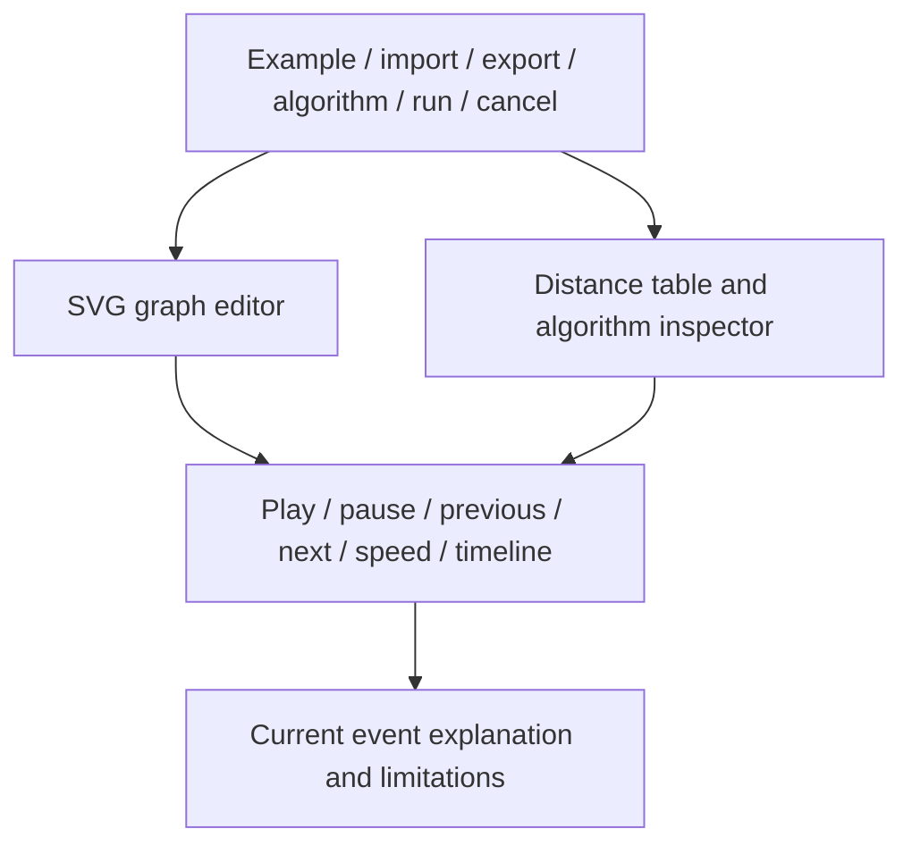

# Element design

**State:** UI specification. Visual implementation pending.

## Layout

Desktop: top toolbar; graph canvas on the left; algorithm inspector on the right; playback timeline below. A separate Results tab presents native benchmark charts. At narrow widths, use stacked canvas and tabbed inspectors; editing remains possible without a second horizontal scrollbar.

Use a light neutral surface, dark text, blue source markers, outlined frontier nodes, and labeled completion markers. Color is redundant with icons/text and never the sole indicator. Start with a branching example and a brief explanation of the project question.

## Component specification

| Element | Behavior and states | Acceptance |
|---|---|---|
| Graph canvas | Select, drag, add/delete nodes; directed arrows; parallel-edge curves; self-loop arcs | Coordinates never affect distances; deletion removes incident edges |
| Edge editor | Pick endpoints, integer weight, stable ID | Reject invalid weights before execution; duplicate IDs rejected |
| Source/target controls | Explicit selectors with canvas shortcuts | Source always valid; unreachable target shows no path |
| Algorithm selector | Dijkstra, BMSSP, compare | Compare runs sequentially on one snapshot |
| Run controls | Loading, ready, running, result, error, cancelled | Run disabled during execution; cancel visibly available |
| Distance table | Original IDs, tentative distances during replay, final distances after execution | Distinguish unknown/tentative from unreachable final values |
| Dijkstra inspector | Ordered logical queue entries and stale removals | Do not claim to display a canonical physical heap layout |
| BMSSP inspector | Active frame, level, bounds, frontier, pivots, returned set | Trace-certified state only; no oracle-derived completion |
| Recursion tree | Expand frames and select recorded frame events | Frame IDs and parent IDs remain consistent |
| Playback | Forward/back, play/pause, speed, event slider | Same state on direct seek and sequential replay |
| Path panel | Selected target's final original-edge path | Validate continuity and weight sum; distinguish it from replay state |
| Benchmark charts | Size/runtime, family comparison, counters, memory | Show native environment, medians/spread, and failures |

## Explanations and examples

Event explanations use plain language: what changed and why it matters. Mathematical definitions are expandable. Default inspectors show a compact view; expert mode exposes internal transformed graph identifiers.

Curated examples cover a chain, branching paths, a directed grid, a zero-weight cycle, and unreachable vertices. Each includes a short prompt and expected final distances. Curated traces must be generated by the current core and show source/build metadata.

## Accessibility

Provide keyboard-accessible forms for graph operations rather than requiring dragging. Use visible focus, labeled inputs, adequate contrast, table headers, and a polite status region for execution state. Avoid announcing every replay event automatically. Respect reduced motion and start paused. Provide a text/table view of graph data.

## Trace and timing presentation

Display `event i of N recorded`, not percentage of computation. Truncated playback ends with a banner and an explicit action to inspect the separately returned final result. A truncated trace must never animate a fabricated final transition.

Browser elapsed time is exploratory and includes its documented timing boundaries. Native charts are labeled as native Python measurements. No speedup badge appears without linked records.

## Editing and recovery

Editing cancels active execution, clears result overlays, and increments graph revision. Import replaces the graph only after validation passes; a failed import preserves the current graph. Runtime-loading failure preserves the graph and permits retry or curated recorded playback.
