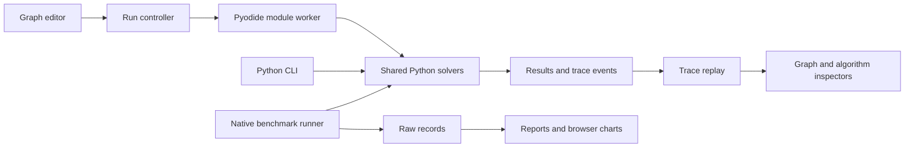

# System design

**State:** specified, not implemented.

## Boundaries

The product has three execution surfaces: native solving, native experiments, and browser exploration. They share solver source but have different timing environments and resource limits. The browser accepts graph data only, never user-provided Python code. There is no backend or database.



## Browser flow

1. Validate graph data and freeze a snapshot with a revision ID.
2. Initialize the worker on first run; display runtime-loading progress.
3. Send a solver request with a unique ID and the frozen graph.
4. Python runs to completion, recording events up to the trace cap.
5. Return the final result and trace envelope. Replay occurs afterward.
6. For comparison, run the other solver sequentially on the identical snapshot.

This is recorded playback, not live single-step execution. Do not imply each animation step has equal computational cost.

```mermaid
sequenceDiagram
    participant UI
    participant Controller
    participant Worker
    participant Python
    UI->>Controller: Run immutable graph revision
    Controller->>Worker: solve(requestId, revision, graph)
    Worker->>Python: solve with TraceRecorder
    Python-->>Worker: result and bounded trace
    Worker-->>Controller: result(requestId, revision)
    Controller-->>UI: Accept matching result; start replay
```

## Cancellation and stale requests

Only one computation is active per worker. Cancel and timeout terminate the worker, clear the active request, and require runtime reinitialization for the next run. Editing while running cancels the run; subsequent graph revisions cannot accept older results. Compare mode cancels both the current run and any queued second run.

Reject messages with mismatched IDs or revisions. Associate data with the original frozen graph and never overlay it on edited vertices. Render error messages as text.

## Native flow

CLI adapters validate and normalize input, choose a solver, invoke the core, and serialize results. The benchmark coordinator generates a graph once per seed, verifies distances outside timing, and controls sequential child processes with invocation timeouts. Parsing, generation, and writing are outside solver timers; reachability and degree transformation are inside end-to-end time.

Use high-resolution monotonic clocks. Time preprocessing and core stages with the same boundary definitions for all records. Distinct memory and counter runs must not contribute to timing statistics.

## Failure behavior

| Failure | Required behavior |
|---|---|
| Invalid graph or source | Show field-level explanation; no worker invocation |
| Runtime load fails/times out | Retry action; curated trace replay remains available |
| Computation fails | Preserve graph, show diagnostic, allow reset/retry |
| Computation exceeds 15 seconds | Terminate worker; mark timeout, not a result |
| Trace exceeds 50,000 events | Stop recording; preserve final result; explain incomplete playback |
| Native correctness mismatch | Save failure record and fixture; exclude from successful timing comparisons |
| Benchmark timeout | Record censored outcome; do not average it as 30 seconds |

## Performance and persistence

Cap editor graphs according to [project specification](PROJECT_SPEC.md). Create trace checkpoints every 250 events during replay ingestion. Keep at most the current comparison's traces in memory. Download/export is explicit; local browser persistence is not required in release 1.

GitHub Pages hosts static files. A pinned Pyodide CDN download is a disclosed initial network dependency; the demo is not advertised as offline. Native reports carry hardware context and browser timings are labeled separately.
